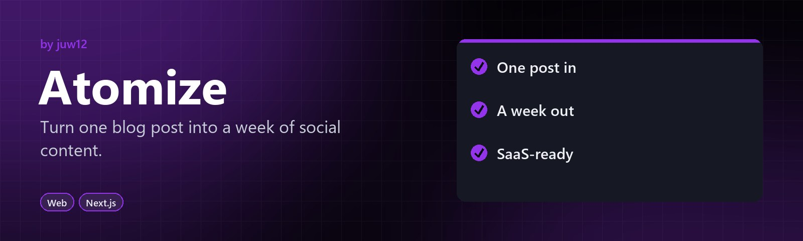

<p align="center">
  <a href="https://juw12.github.io/atomize/"></a>
</p>

# Atomize

**Turn one article into a week of posts.** Paste a blog post and get LinkedIn posts, a numbered tweet thread, a newsletter and a short-video script. It runs entirely in your browser: nothing is uploaded and there is no AI bill.

**Try it:** https://juw12.github.io/atomize/

## What you get

| Format | Default | Rule |
| --- | --- | --- |
| LinkedIn posts | 5 | Hook + supporting line + hashtags, each under 1,300 characters |
| Tweet thread | 8 | Numbered `1/8 … 8/8`, each under 280 characters |
| Newsletter | 1 | Subject line, three-sentence summary, key points |
| Short-video script | 1 | Hook (0-3 s), timed beats, close |

Each output has its own Copy button.

## How it works

`atomize.js` is a small, dependency-free engine. It splits the article into sentences, scores each one by keyword frequency and position, and picks the strongest sentences for each format. It's extractive, which means every line comes from your own words, so nothing is made up. The same input always gives the same output.

## Run locally

Open `index.html` in a browser. No build step is needed.

```
node tests/engine.test.js          # engine checks (CI runs these)
python tests/test_atomize.py       # browser checks (needs Playwright)
```

## Files

- `atomize.js`: the engine (works in the browser and in Node)
- `app.js`: the page logic (input, counts, copy buttons)
- `index.html`, `style.css`: the UI
- `tests/`: engine and browser tests

## History

Earlier commits held copies of other apps from the [projects](https://github.com/juw12/projects) monorepo by mistake. They were removed in the commit that added this app, and git history still has them.

MIT licensed. More by [juw12](https://github.com/juw12).
